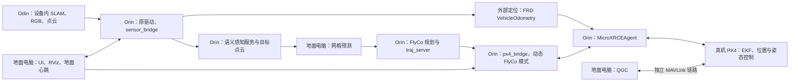

# 真机双机部署：地面电脑与 Orin

依据当前 `dev-real` 分支（审阅提交 `ebdc3a05cfdfd288f1d39a51e9e8e60fea080884`）的实际 launch、配置、构建文件和控制实现整理。

下面采用工程已有的 **Ubuntu 22.04 / ROS2 Humble + Orin + Odin + PX4 原生 FlyCo 模式** 分工。板卡型号、JetPack、固件和接线尚未确认，涉及这些信息的地方给出条件和替换位置；这里的命令未在真机上执行。已有仿真验收见 [dev-real-status.md](dev-real-status.md)，它使用了定制 PX4 固件，未包含 ARM64、双机无线网络和硬件飞行验收。

## 1. 架构与部署边界



| 位置 | 实际入口与职责 |
|---|---|
| `sim/`、`bridge/`、`launch.py` | Isaac/Pegasus 仿真、传感器和 TCP 桥；真机日常启动不经过这一层 |
| `third_party/flyco_ros2` | 沿用的感知、点云聚类、网格预测、覆盖规划及轨迹算法 |
| `ros2/flyco_real` | 真机传感器归一化、TF、PX4 DDS、模式注册、任务调度和按设备拆分的 launch |
| `third_party/drivers/odin_ros_driver` | Odin USB 驱动；按 x86_64 / aarch64 选择 SDK |
| `third_party/px4_msgs` | PX4 消息定义；必须与实际固件协调使用 |
| `third_party/ros_interfaces` | 四个算法消息/服务包；包名里保留 AirSim 不代表真机需要运行 AirSim |
| `third_party/SAM_AD_Perception` | 通过 HTTP 接入的语义模型服务，默认在 Orin 的 `127.0.0.1:8851` |

机载的主数据流为：

```text
/odin1/* → sensor_bridge → /flyco/odom、/flyco/lidar/world、/flyco/camera/*
                       → /fmu/in/vehicle_visual_odometry → PX4 EKF
图像 + 文字 → 本机语义服务 → 目标点云 → 地面预测 → /prediction/predicted_mesh
网格 + 定位 → flyco_planner → traj_server → /planning/pos_cmd
            → px4_bridge → PX4 trajectory_setpoint → 飞控控制器
```

机内使用 ENU / FLU；PX4 接口执行坐标转换和局部原点对齐。外部定位当前只保证位姿，速度和角速度写为 NaN，不应据此开启外部速度融合。

真机运行不需要 Isaac Sim、Pegasus 或 SITL。ROS2 双机链路承载预测输入、网格、可视化和地面心跳；MicroXRCEAgent 承载 Orin 到飞控的数据；QGC 使用独立 MAVLink 链路。启动 Agent 不会自动把飞控连接到 QGC。

## 2. 先收集两端信息

地面电脑执行：

```bash
cat /etc/os-release
uname -m
nvidia-smi
ls /opt/ros
command -v nvcc
```

Orin 执行：

```bash
cat /etc/os-release
uname -m
cat /etc/nv_tegra_release
dpkg-query -W nvidia-jetpack nvidia-l4t-core
python3 --version
ls -l /dev/serial/by-id/
lsusb
```

`nvidia-jetpack` 元包或 `by-id` 目录不存在不等于设备不可用，分别继续检查 L4T 版本和实际 UART 设备。PX4 在 QGC 的 MAVLink Console 中执行：

```text
ver all
uxrce_dds_client status
param show UXRCE_DDS_DOM_ID
param show UXRCE_DDS_CFG
```

当前源码的原生模式依赖 `RegisterExtComponentRequest/Reply`、`ArmingCheckRequest/Reply`、`ModeCompleted`、`vehicle_command_mode_executor` 等接口。不能根据“同为 PX4”或“能看到遥测”判断接口兼容。旧仿真页中的 v1.14.3 是 Pegasus/SITL 说明，不是当前真机动态模式的部署版本要求。

工程已将用户提供的 PX4 1.17 定制源码消息直接放入 `third_party/px4_msgs`，来源为 `feature/neural` 提交 `0d092a91f0c0417ab888b4bc37331484e6d46b9d`，详细校验和见该包 `SOURCE.json`。两端统一 `colcon build`，注册、解锁检查及本地位置接口直接使用对应 `_v1` 话题，不需要额外消息覆盖层或转换节点。实际飞控报告的提交为 `f026a1d…`，仍需机载确认接口运行结果。[PX4 ROS2 消息匹配说明](https://docs.px4.io/v1.16/en/ros2/user_guide)、[原生模式接口](https://docs.px4.io/v1.16/en/ros2/px4_ros2_control_interface)。

## 3. 两端公共准备

以下公共安装块适用于已经安装 ROS2 Humble、已配置 Ubuntu/ROS 软件源的 Ubuntu 22.04。板卡使用其他系统版本时，先处理 ROS / Python ABI；不要把这些 apt 命令当作跨系统安装器。ROS 首次安装见 [Humble 官方安装说明](https://docs.ros.org/en/humble/Installation/Ubuntu-Install-Debians.html)。

### 3.1 获取相同源码

地面电脑当前目录就是 `/home/lyl/Coal_FlyCo`，可以直接使用。新设备执行：

```bash
git clone --branch dev-real https://github.com/Yuan-Lin-Liu/Coal_FlyCo.git "$HOME/Coal_FlyCo"
cd "$HOME/Coal_FlyCo"
git rev-parse HEAD
```

两端记录并核对提交；如果远程分支已有更新，应选择同一提交。仓库不包含 `.local/` 内的 Python 环境、权重和 CUDA 扩展，拉取源码不会自动获得这些资源。

### 3.2 安装公共依赖

两端执行：

```bash
sudo apt update
sudo apt install -y \
  build-essential gcc-11 g++-11 cmake ninja-build git curl pkg-config \
  python3-dev python3-pip python3-venv python3-rosdep \
  python3-colcon-common-extensions python3-colcon-defaults \
  python3-numpy python3-scipy python3-opencv python3-yaml python3-transforms3d \
  libeigen3-dev libpcl-dev libompl-dev libyaml-cpp-dev libtbb-dev \
  libopencv-dev libusb-1.0-0-dev libssl-dev libopenblas-dev \
  ros-humble-ros-base ros-humble-rviz2 ros-humble-rmw-fastrtps-cpp \
  ros-humble-cv-bridge ros-humble-geographic-msgs \
  ros-humble-image-transport ros-humble-image-geometry \
  ros-humble-message-filters ros-humble-pcl-conversions \
  ros-humble-tf2-geometry-msgs ros-humble-tf2-sensor-msgs \
  ros-humble-sensor-msgs-py ros-humble-rosgraph-msgs chrony
```

安装 `colcon-defaults` 很关键：根目录 `colcon_defaults.yaml` 才会自动限定源码搜索路径，避免递归扫描整个第三方模型树。

Jetson 上还需核对 Odin 与 `cv_bridge` 链接的是同一 OpenCV ABI；NVIDIA 预装版与 ROS apt 版混用可能在首帧图像到达时崩溃，驱动 README 的 5.16 节有排查说明。不要在不知道现有软件依赖的情况下直接替换系统 OpenCV。

当前机载实测有 NVIDIA `libopencv-dev 4.8.0-1-g6371ee1`，其 `/usr/lib/cmake/opencv4` 配置引用了不存在的 `/usr/lib/libopencv_core.so.4.8.0`；ROS Humble 的 `libcv_bridge.so` 则链接系统 `libopencv_*.so.4.5d`。对于这一已确认的组合，选择软件源中匹配的 Ubuntu 4.5.4 开发包，并指定标准 ARM64 CMake 配置目录：

```bash
sudo apt install --allow-downgrades libopencv-dev=4.5.4+dfsg-9ubuntu4

cd "$HOME/Coal_FlyCo"
source /opt/ros/humble/setup.bash
export OpenCV_DIR=/usr/lib/aarch64-linux-gnu/cmake/opencv4
export CMAKE_PREFIX_PATH="$PWD/.local/deploy/embree3${CMAKE_PREFIX_PATH:+:$CMAKE_PREFIX_PATH}"
export LD_LIBRARY_PATH="$PWD/.local/deploy/embree3/lib${LD_LIBRARY_PATH:+:$LD_LIBRARY_PATH}"

test -f "$OpenCV_DIR/OpenCVConfig.cmake" &&
colcon build --packages-skip-build-finished --cmake-clean-cache &&
source install/setup.bash
```

`--packages-skip-build-finished` 保留已成功构建的包，继续处理失败及尚未构建的包；`--cmake-clean-cache` 清除其中失败的 CMake 路径选择。其他机器须先核对 `apt-cache policy libopencv-dev libopencv-core-dev` 与 `ldd /opt/ros/humble/lib/libcv_bridge.so`，再选择版本。

### 3.3 创建车辆配置

两端在工程根目录执行；已有配置时保留原文件：

```bash
cp -n ros2/flyco_real/config/odin.yaml config/vehicle.odin.local.yaml
```

先在 Orin 核对配置，再将相同车辆配置同步到地面电脑。需要实测或选择的字段：

| 字段 | 作用 |
|---|---|
| `sensor_bridge.ros__parameters.odometry_is_body_frame` | Odin 配置自动启用；IMU 与机体原点、轴向重合，不做安装外参补偿 |
| `sensor_bridge.ros__parameters.world_from_lio_*` | SLAM 世界系与规划 `world` 的关系 |
| `sensor_bridge.ros__parameters.publish_external_vision` | 是否由本工程向 PX4 发送外部定位，避免和原定位桥重复发布 |
| `px4_bridge.ros__parameters.bounds_min/max` | 基于实际 `world` 坐标的执行边界 |
| `px4_bridge.ros__parameters.max_speed/max_acceleration` | 指令检查上限，需要与规划参数协调 |
| `px4_bridge.ros__parameters.takeoff_height` | 自动起飞高度；模板未写出，代码默认 2.0 m |
| `flyco_planner.ros__parameters.flyco_planner.initial_height` | 规划初始化高度，修改起飞高度时一并核对 |
| `sam_tracking.ros__parameters.segmentation_endpoint` | 默认保持 `http://127.0.0.1:8851`，语义服务在 Orin |

Odin 内部的相机内参、去畸变和传感器间 TF 由原驱动处理。本工程不再启动额外外参适配节点，默认零安装偏移；保留 `world → odom`、`world → base_link` 和驱动原生 TF。桥接图像和 CameraInfo 的帧名统一为原驱动光学 TF `camera_0`，PX4 坐标约定转换继续保留。旧车辆配置中的安装外参字段被忽略。

## 4. Orin 首次部署

### 4.1 构建 ARM64 Embree 3

工程的 ARM 构建要求 Embree **3**。Ubuntu 22.04 的 `libembree-dev` 官方包仅提供 amd64，不能把该包或仓库内的 x86 `.so` 复制到 Orin；Ubuntu 24.04 提供的 Embree 4 也不满足本工程的 `find_package(embree 3 ...)`。[Ubuntu 包信息](https://packages.ubuntu.com/libembree-dev)。

Linux ARM64 构建须显式设置 `EMBREE_ARM=ON`。3.13.5 在加载 GNU 编译选项之后才自动检测 NEON，仅指定 `EMBREE_MAX_ISA=NEON` 可能留下 x86 的 `-msse2` 编译参数。GCC 11 编译该版本的 NEON 兼容头文件还需 `-flax-vector-conversions`；同时关闭 `EMBREE_IGNORE_CMAKE_CXX_FLAGS`，避免 Embree 清空传入的 C++ 选项。以下命令仍需在 Orin 上完成编译验收：

```bash
cd "$HOME/Coal_FlyCo"
mkdir -p .local/deploy/src
git clone --branch v3.13.5 --depth 1 \
  https://github.com/RenderKit/embree.git .local/deploy/src/embree
cmake -S .local/deploy/src/embree -B .local/deploy/build/embree -GNinja \
  -DCMAKE_BUILD_TYPE=Release \
  -DCMAKE_INSTALL_PREFIX="$PWD/.local/deploy/embree3" \
  -DEMBREE_ARM=ON \
  -DEMBREE_IGNORE_CMAKE_CXX_FLAGS=OFF \
  -DCMAKE_CXX_FLAGS=-flax-vector-conversions \
  -DEMBREE_ISPC_SUPPORT=OFF -DEMBREE_TUTORIALS=OFF \
  -DEMBREE_MAX_ISA=NEON &&
cmake --build .local/deploy/build/embree --parallel 2 &&
cmake --install .local/deploy/build/embree
export CMAKE_PREFIX_PATH="$PWD/.local/deploy/embree3${CMAKE_PREFIX_PATH:+:$CMAKE_PREFIX_PATH}"
export LD_LIBRARY_PATH="$PWD/.local/deploy/embree3/lib${LD_LIBRARY_PATH:+:$LD_LIBRARY_PATH}"
```

已经有本机 ARM64 Embree 3 时复用其安装前缀，无需重新构建。[上游版本与 ARM 检测](https://github.com/RenderKit/embree/blob/v3.13.5/CMakeLists.txt)。

若已有失败配置并报 `unrecognized command-line option '-msse2'`，复用源码和构建目录，以 `cmake -U 'FLAGS_*'` 加上述完整配置参数重新配置，再在构建成功后执行安装。

若报 `cannot convert int64x2_t to __m128i` 或其他 NEON 向量转换错误，核对实际编译命令是否包含 `-flax-vector-conversions`；仅设置 `CMAKE_CXX_FLAGS` 而不关闭 `EMBREE_IGNORE_CMAKE_CXX_FLAGS` 不会生效。参见 [NVIDIA 对 GCC 向量转换选项的说明](https://github.com/NVIDIA/grace-cpu-benchmarking-guide/blob/main/src/developer/vectorization.md#relaxed-vector-conversions)。

### 4.2 编译 ROS 工作区

在前一步同一终端执行：

```bash
source /opt/ros/humble/setup.bash
colcon build
source install/setup.bash
ros2 pkg executables flyco_real
ldd install/odin_ros_driver/lib/odin_ros_driver/host_sdk_sample
```

默认构建 8 个包，顺序编译、最多两个编译任务。Odin 选择 `liblydHostApi_arm.a`，LKH/kdline 在目标 CPU 编译，旧仿真控制器默认关闭。

### 4.3 配置设备权限

```bash
cd "$HOME/Coal_FlyCo"
sudo usermod -aG dialout,plugdev "$USER"
sudo install -m 0644 ros2/flyco_real/config/udev/99-coal-odin.rules \
  /etc/udev/rules.d/99-coal-odin.rules
sudo udevadm control --reload-rules
sudo udevadm trigger
```

重新登录并重新插拔设备后再启动驱动。Odin 使用 USB 权限，飞控/UART 使用串口权限；不要依赖每次启动都变化的 `/dev/ttyACM0` 编号，USB 转串口优先使用 `/dev/serial/by-id/...`，板载 UART 使用载板实际设备名。

### 4.4 安装 DDS Agent

当前 Orin 尚未安装 Agent。其已有源码使用 Fast DDS `3.3.x`，属于 v3 Agent 构建；PX4 v1.17 官方说明默认 v2 客户端与 v3 Agent 不兼容。ROS2 Humble 复用系统 DDS 库时采用官方对应的 Agent `v2.4.2`。已有与固件匹配且正常工作的 Agent 时继续复用。

本地已准备 `runtime/deploy/Micro-XRCE-DDS-Agent-2.4.2-humble-src.tar.gz`，包含官方 v2.4.2 源码及 `config/xrce_agent_humble_presets.json` 对应的构建配置。该包不包含编译产物；配置复用 Humble 的 Fast DDS 2.x、Fast CDR 1.x 和系统 spdlog，关闭 superbuild 及无需用于 PX4 UDP/串口链路的 Agent P2P 配置，从而避免构建过程再次访问 GitHub。

地面电脑发送：

```bash
cd "$HOME/Coal_FlyCo"
scp runtime/deploy/Micro-XRCE-DDS-Agent-2.4.2-humble-src.tar.gz \
  buaa-lab-01@192.168.8.204:~/
```

Orin 安装匹配的开发依赖，解压到独立源码目录后编译：

```bash
sudo apt install -y ros-humble-fastrtps ros-humble-fastcdr libspdlog-dev
tar -xzf "$HOME/Micro-XRCE-DDS-Agent-2.4.2-humble-src.tar.gz" -C "$HOME"
cd "$HOME/Micro-XRCE-DDS-Agent-2.4.2-humble"
source /opt/ros/humble/setup.bash
cmake --preset orin-humble &&
cmake --build --preset orin-humble &&
sudo cmake --install build &&
sudo ldconfig
command -v MicroXRCEAgent
```

上述配置与编译已在本地 x86_64 Humble 完成验证，ARM64 编译及飞控连接仍由机载验证。旧的 `~/Micro-XRCE-DDS-Agent` 目录保留，源码与失败构建不混用。[PX4 v1.17 Agent 安装与版本对应表](https://docs.px4.io/v1.17/en/middleware/uxrce_dds#micro-xrce-dds-agent-installation)。

### 4.5 准备语义模型服务

语义服务可以运行在 Orin，也可以运行在地面电脑。推荐先让有完整 NVIDIA GPU 环境的地面电脑运行 SAM2，Orin 通过 HTTP 发送图像和文本并接收 mask。模型服务与 ROS Python 3.10 通过 HTTP 隔离，可以使用独立 Python 环境，但 Torch、torchvision、CUDA 和 Python ABI 必须匹配。

先按板卡实际 JetPack，使用 [NVIDIA Jetson PyTorch 安装与兼容说明](https://docs.nvidia.com/deeplearning/frameworks/install-pytorch-jetson-platform/) 选择环境。这里不指定未知的 wheel URL。当前模型依赖以 Python 3.12 为基线；若 JetPack 对应的现成 wheel 只有 cp310，不能将其安装进 Python 3.12，需另做受支持环境或源码构建适配。这是完整机载感知部署的前置条件。

已准备好兼容的语义环境后执行，替换第一行路径：

```bash
cd "$HOME/Coal_FlyCo"
export PATH="$PWD/.local/bin:$PATH"
export UV_CACHE_DIR="$PWD/.local/uv-cache" UV_PYTHON_INSTALL_DIR="$PWD/.local/uv-python"
uv venv --python 3.12 .local/deploy/semantic
export SEMANTIC_PYTHON="$PWD/.local/deploy/semantic/bin/python"
"$SEMANTIC_PYTHON" -c 'import sys, torch, torchvision; print(sys.version, torch.__version__, torchvision.__version__, torch.version.cuda); assert sys.version_info >= (3, 12); assert torch.cuda.is_available()'
uv pip install --python "$SEMANTIC_PYTHON" -r third_party/SAM_AD_Perception/requirements-server.txt
cd third_party/SAM_AD_Perception
"$SEMANTIC_PYTHON" -B prepare_assets.py --backend A
PYTHONPATH="$PWD:$PWD/sam2-official:$PWD/third_party/efficientsam3" \
  "$SEMANTIC_PYTHON" -B -m sam_ad.doctor --backend A --skip-integrity
```

`doctor` 检查 CUDA tensor 和 torchvision GPU NMS；本次部署跳过文件哈希校验。仍需在第 8 节发送真实目标文字，验证端到端推理与时延。权重及锁定的上游源码可以从远程已验证机器按原路径复制，Python 虚拟环境及二进制扩展需要针对本机建立。

#### 地面电脑运行 SAM2，Orin 远程调用

地面电脑使用项目内 `uv` 环境；完成第 4.5 节的依赖准备后，从工程根目录启动：

```bash
cd "$HOME/Coal_FlyCo"
source .local/setup/ground-env.sh
source .local/deploy/semantic.env
ros2 launch flyco_real semantic.launch.py
```

该 ROS2 launch 默认使用 `.local/deploy/semantic/bin/python`、监听地址 `0.0.0.0`、端口 `8851`，并跳过文件哈希校验。地面服务与机载客户端均加载相同的 `semantic.env` 鉴权配置。先用 `ip -br -4 addr` 查出地面电脑在本机网段的地址：

```bash
source .local/deploy/semantic.env
curl --noproxy "*" -sS \
  -H "Authorization: Bearer ${SAM_AD_API_TOKEN}" \
  "http://127.0.0.1:8851/health"
```

服务就绪后，在 Orin 上验证（将 `GROUND_IP` 换成地面电脑 IP）：

```bash
curl --noproxy "*" -sS \
  -H "Authorization: Bearer ${SAM_AD_API_TOKEN}" \
  "http://${GROUND_IP}:8851/health"
```

Orin 的跟踪入口通过启动参数指定远程服务，不需要在 Orin 再启动一份语义服务：

```bash
ros2 launch flyco_real native.launch.py \
  role:=onboard \
  config:="$PWD/config/vehicle.odin.local.yaml" \
  start_sensors:=false \
  start_mode:=false \
  segmentation_endpoint:="http://${GROUND_IP}:8851" \
  segmentation_timeout:=15.0
```

这里的 `GROUND_IP` 是地面电脑地址，不能写 Orin 自己的 `127.0.0.1`。`semantic.launch.py` 的 `bind` 参数和 `native.launch.py` 的远程 endpoint/timeout 参数由 `flyco_real` 提供；无需修改 HTTP provider。完整飞行入口使用同样的 `segmentation_endpoint` 和 `segmentation_timeout` 参数，并设置 `start_semantic:=false`。

## 5. 地面电脑首次部署

### 5.1 编译 ROS 工作区

在已安装第 3 节公共依赖的终端执行：

```bash
cd "$HOME/Coal_FlyCo"
source /opt/ros/humble/setup.bash
colcon build
source install/setup.bash
```

地面电脑也默认构建全部包，实际只启动地面角色；x86 默认复用仓库的 x86 Embree 3。

### 5.2 安装地面预测环境

`colcon build` 只构建 ROS 包，不会创建预测 Python 环境或下载模型。项目使用 `.local/bin/uv` 管理 Python 环境；新 x86_64 地面电脑可在已完成 ROS 构建后执行：

```bash
bash tools/setup_ground_predictor.sh
```

脚本将环境安装到 `.local/deploy/predictor`，只下载地面预测需要的模型；缺少 CUDA 11.8 时在 `.local/deploy/cuda-root/usr/local/cuda-11.8` 解包所需编译工具和 cuSPARSE，不安装或替换系统驱动，不设置 ROS 域。首次安装需要联网、GPU 可用以及编译工具。在没有系统 CUDA 11.8、采用此项目内安装时，后面的地面 launch 使用 `cuda_home:="$PWD/.local/deploy/cuda-root/usr/local/cuda-11.8"`。

下面保留分步安装方式，便于已有环境的机器按需复用；环境创建和依赖安装仍使用 `uv`。

已有能运行本工程的 Python 3.10 / Torch 2.3.1 / CUDA 11.8 / NKSR 环境时可直接复用路径；只需验证下面的导入。全新 x86_64 电脑先保证 NVIDIA 驱动工作且有 CUDA 11.8 的 `nvcc`。CUDA 11.8 安装说明见 [NVIDIA 文档](https://docs.nvidia.com/cuda/archive/11.8.0/cuda-installation-guide-linux/index.html)。

仅当本机缺少该 Toolkit，且确认为 Ubuntu 22.04 x86_64 时，可安装：

```bash
curl -fL https://developer.download.nvidia.com/compute/cuda/repos/ubuntu2204/x86_64/cuda-keyring_1.1-1_all.deb \
  -o /tmp/coal-flyco-cuda-keyring.deb
sudo dpkg -i /tmp/coal-flyco-cuda-keyring.deb
sudo apt update
sudo apt install -y cuda-toolkit-11-8
```

RTX 3090/4090 的环境可参考本工程已有验证组合；如果是更新且 CUDA 11.8 不支持的 GPU，需重新适配 Torch/NKSR/扩展，不能继续照用该组合。

以下从 `docker/Dockerfile.flyco` 提取原生预测环境安装步骤：

```bash
cd "$HOME/Coal_FlyCo"
mkdir -p .local/deploy/src
export PATH="$PWD/.local/bin:$PATH"
export UV_CACHE_DIR="$PWD/.local/uv-cache" UV_PYTHON_INSTALL_DIR="$PWD/.local/uv-python"
uv venv --python /usr/bin/python3 --system-site-packages .local/deploy/predictor
export PREDICTOR_PYTHON="$PWD/.local/deploy/predictor/bin/python"
export CUDA_HOME=/usr/local/cuda-11.8
export PATH="$CUDA_HOME/bin:$PATH"
export LD_LIBRARY_PATH="$CUDA_HOME/lib64${LD_LIBRARY_PATH:+:$LD_LIBRARY_PATH}"
export CC=gcc-11 CXX=g++-11 MAX_JOBS=2
uv pip install --python "$PREDICTOR_PYTHON" 'pip<25' setuptools==69.5.1 wheel
uv pip install --python "$PREDICTOR_PYTHON" torch==2.3.1 torchvision==0.18.1 \
  --index-url https://download.pytorch.org/whl/cu118
uv pip install --python "$PREDICTOR_PYTHON" -r docker/requirements.txt
uv pip install --python "$PREDICTOR_PYTHON" --no-index --no-deps \
  -f https://data.pyg.org/whl/torch-2.3.0+cu118.html torch-scatter==2.1.2+pt23cu118
"$PREDICTOR_PYTHON" -c 'import torch; assert torch.cuda.is_available(); print(torch.cuda.get_device_name(), torch.cuda.get_device_capability())'
```

NKSR 使用与仓库容器相同的固定源码版本：

```bash
git init .local/deploy/src/NKSR
git -C .local/deploy/src/NKSR remote add origin https://github.com/nv-tlabs/NKSR.git
git -C .local/deploy/src/NKSR fetch --depth 1 origin e40336845e67761343a756788e5a98b827d4a143
git -C .local/deploy/src/NKSR checkout FETCH_HEAD
git init .local/deploy/src/NKSR/package/external/openvdb
git -C .local/deploy/src/NKSR/package/external/openvdb remote add origin \
  https://github.com/AcademySoftwareFoundation/openvdb.git
git -C .local/deploy/src/NKSR/package/external/openvdb fetch --depth 1 origin \
  7edd8cd86f105a01a41ad7b2bf59a81034cd79fb
git -C .local/deploy/src/NKSR/package/external/openvdb checkout FETCH_HEAD
git clone --depth 1 --branch 3.4 https://gitlab.com/libeigen/eigen.git \
  .local/deploy/src/NKSR/package/external/eigen
uv pip install --python "$PREDICTOR_PYTHON" --no-build-isolation .local/deploy/src/NKSR/package
```

准备权重并首次编译 PointNet2 扩展：

```bash
"$PREDICTOR_PYTHON" tools/download_models.py --directory "$PWD/.local/flyco/models"
"$PREDICTOR_PYTHON" tools/download_models.py --directory "$PWD/.local/flyco/models" --huggingface
source /opt/ros/humble/setup.bash
source install/setup.bash
export TORCH_EXTENSIONS_DIR="$PWD/.local/deploy/torch_extensions"
mkdir -p "$TORCH_EXTENSIONS_DIR"
"$PREDICTOR_PYTHON" -c 'import rclpy, cv_bridge, torch, nksr; from pointnet2_ops import pointnet2_utils; print("Ground predictor imports OK")'
```

PointNet2 会在缺少本机兼容二进制时 JIT 编译。首次编译需有 CUDA Toolkit；不要把别台机器的 Torch 扩展缓存直接拿来用。上面的模型工具校验完整仿真模型清单，可能下载比真机地面预测所需更多的资源；已有远程缓存可以复制模型目录后运行 `--check`。

### 5.3 QGC

复用远程验证过、支持动态模式列表的 QGC 版本；v1.16 官方接口文档使用 QGC Daily。启动实际下载的 AppImage：

```bash
chmod +x /absolute/path/to/QGroundControl.AppImage
/absolute/path/to/QGroundControl.AppImage
```

QGC 通过数传、独立串口或已配置的 MAVLink UDP 连接真机。独立链路应在启动 FlyCo 前就能显示车辆。飞控接 Orin 的 USB/TELEM 口若用于 XRCE，不能同时再让 MAVLink 占用同一串口。

## 6. 双机网络、时间与每个终端环境

当前 Orin 机载电脑地址为 **192.168.8.204**，DDS 域为 **3**，地面电脑地址为 **192.168.8.181**。两端运行终端使用同一域。`deployment.ros_domain_id` 是配置记录，当前 launch 不会据此自动设置终端环境。

每个运行终端都先执行：

```bash
cd "$HOME/Coal_FlyCo"
source /opt/ros/humble/setup.bash
source install/setup.bash
export ROS_DOMAIN_ID=3
export ROS_LOCALHOST_ONLY=0
export RMW_IMPLEMENTATION=rmw_fastrtps_cpp
```

本地 `.local/setup/ground-env.sh` 和 Fast DDS 配置已按上述机载地址与域配置。接入 PX4 时还需核对飞控 `UXRCE_DDS_DOM_ID`，使其与 ROS 节点使用同一域。本工程已包含配套消息定义，运行终端仅加载本工程环境。

终端中的 `export` 对当前终端及其子进程生效。要让机载每个新 Bash 终端自动加载，使用 `config/onboard.env`；文件按自身位置确定工程根目录，加载 ROS2、工程覆盖层、Domain 3、机载 DDS XML、Embree 路径和已有的 `.local/deploy/semantic.env`。它只配置环境，不启动节点。

在地面电脑同步配置：

```bash
cd "$HOME/Coal_FlyCo"
scp config/onboard.env \
  buaa-lab-01@192.168.8.204:~/Coal_FlyCo/config/
scp .local/deploy/fastdds-orin.xml \
  buaa-lab-01@192.168.8.204:~/Coal_FlyCo/.local/deploy/
```

在 Orin 上执行一次，之后新终端及重启后的终端自动加载：

```bash
flyco_env_line='source "$HOME/Coal_FlyCo/config/onboard.env"'
grep -qxF "$flyco_env_line" "$HOME/.bashrc" ||
  printf '\n%s\n' "$flyco_env_line" >> "$HOME/.bashrc"
unset flyco_env_line
source "$HOME/Coal_FlyCo/config/onboard.env"
printenv ROS_DOMAIN_ID ROS_LOCALHOST_ONLY RMW_IMPLEMENTATION FASTRTPS_DEFAULT_PROFILES_FILE
```

此方式适用于该用户终端启动的节点；systemd 服务需要在服务定义中加载环境。DDS XML 文件和 `/etc/systemd/timesyncd.conf.d/99-flyco-ntp.conf` 本身是持久文件。Wi-Fi IP 地址的固定由网络配置负责，建议在路由器上将机载 MAC 保留为 `192.168.8.204`，地面电脑保留为 `192.168.8.181`。

DDS XML 是可选配置，用于限定网卡和指定发现对端。两台电脑处于允许 DDS 组播的同一局域网时，可以使用默认发现。环境入口在 XML 不存在时清除文件变量，保留 Domain 3 和 Fast DDS RMW；当前终端也可执行 `unset FASTRTPS_DEFAULT_PROFILES_FILE FASTDDS_DEFAULT_PROFILES_FILE` 后再启动节点。已存在的 XML 会继续加载。

机载独立启动 Odin 原始驱动时，本地接收入口使用 `start_driver:=false`。将该设备的标定文件复制到本地，在 `config/vehicle.odin.local.yaml` 的 `perception_bridge.ros__parameters.odin_calibration_file` 中指定固定路径，当前为 `/home/pq/.ros/odin_ros_driver/calib.yaml`。该文件不会通过 DDS 自动同步；本地启动驱动的模式仍由启动入口指定本次运行的标定目录。

运行配置统一生成到固定的 `runtime_root/native/`，重复启动时覆盖 `parameters.yaml`、`prediction_runtime.yaml`，硬件入口还会覆盖 `odin_control.yaml`。`hardware.launch.py`、`native.launch.py` 的默认目录为 `~/.ros/coal-flyco/native/`；`ground.launch.py` 在当前本地环境下使用 `.local/deploy/runs/native/`。修改参数仍编辑源车辆 YAML，生成文件会在下次启动时被覆盖。已有 `odin/calib.yaml` 会保留，旧的 `native-随机字符/` 目录不再创建，也不会自动删除。

Orin 再加载本机 Embree 前缀；地面再设置预测扩展缓存：

```bash
# 仅 Orin；按第 4.1 节安装时使用
export LD_LIBRARY_PATH="$PWD/.local/deploy/embree3/lib${LD_LIBRARY_PATH:+:$LD_LIBRARY_PATH}"
```

```bash
# 仅地面电脑；与首次编译 PointNet2 使用同一个缓存
export TORCH_EXTENSIONS_DIR="$PWD/.local/deploy/torch_extensions"
```

不要 source `tools/flyco_env.sh`：它为旧仿真设置域 64、`ROS_LOCALHOST_ONLY=1`，并清空覆盖层、注入 x86 库路径。真机命令也不带 `simulation:=true` 或 `--sim`。

两端检查：

```bash
chronyc tracking
chronyc sources -v
ros2 multicast receive
```

另一台机器运行：

```bash
ros2 multicast send
```

两端时钟必须实际同步；无互联网时可让地面电脑作为内网 NTP 源，Orin 指向该源。只检查时区相同不足以保证时间一致。ROS multicast 测试通过后，还需用第 8 节的 ROS 话题验证 DDS 数据传输；无线 AP 客户端隔离、防火墙或 VPN 可能影响发现和大消息传输。

该工程默认把原始 RGB、点云和网格送到地面可视化/预测，需实测无线带宽与时延。不能只凭 `ping` 通判断足够承载完整算法。

## 7. PX4 配置核对

飞控端和 Linux 端是两个配置面：在 Orin 启动 Agent，不会自动启动/配置飞控的 XRCE 客户端。

如果实际接线选择 **PX4 TELEM2 → Orin 串口，921600 baud**，在 QGC 参数页将 `UXRCE_DDS_CFG` 选择为 TELEM2，`SER_TEL2_BAUD` 设为 921600，`UXRCE_DDS_DOM_ID` 设为选定域。停止占用 TELEM2 的其他串口功能；QGC 使用另一条 MAVLink 链路。USB/网口/其他 UART 的配置按实际接口选择，不照搬 TELEM2 参数。

QGC MAVLink Console 先只读检查：

```text
uxrce_dds_client status
param show UXRCE_DDS_CFG
param show UXRCE_DDS_DOM_ID
param show UXRCE_DDS_PTCFG
param show UXRCE_DDS_SYNCT
param show EKF2_EV_CTRL
param show EKF2_HGT_REF
param show EKF2_EV_DELAY
param show EKF2_EV_POS_X
param show EKF2_EV_POS_Y
param show EKF2_EV_POS_Z
```

`UXRCE_DDS_PTCFG=1` 会把 DDS 限制到 localhost，需要与双机通信方式协调；外部定位时间戳依赖 XRCE 时间同步，需核对 `UXRCE_DDS_SYNCT`。外部定位融合选择水平位置、需要时的高度与航向；当前输出不支持外部速度融合。延迟和安装补偿依据实际链路设置，收到 `/fmu/in/vehicle_visual_odometry` 不代表 EKF 已融合成功。变更需重启的参数后重启并重新检查。

本机的 `sensor_bridge` 已将定位变换至 `base_link`；核对 PX4 的定位偏移参数，避免再次补偿 Odin 的同一杆臂。依据：[XRCE 配置](https://docs.px4.io/v1.16/en/middleware/uxrce_dds)、[外部定位融合](https://docs.px4.io/v1.16/en/ros/external_position_estimation)。

## 8. 日常启动命令：按顺序、每块一个终端

每个终端先执行第 6 节公共环境。下面假设第 4/5 节已完成，并已核对固件接口、车辆安装关系和 PX4 外部定位融合。

### 8.1 Orin A：DDS Agent

串口连接时替换设备名，波特率与飞控端一致：

```bash
ros2 launch flyco_real agent.launch.py \
  transport:=serial device:=/dev/serial/by-id/REPLACE_WITH_ACTUAL_DEVICE baudrate:=921600
```

如果实际是 UDP 连接，则改用下方命令，并在 PX4 中配置 Agent 为 Orin 的真实 IP；二者只运行实际使用的一个：

```bash
ros2 launch flyco_real agent.launch.py transport:=udp4 port:=8888
```

已有 Agent 时复用，不重复启动同一通道的 Agent。

### 8.2 Orin B：Odin 定位、标定与传感器桥

```bash
ros2 launch flyco_real hardware.launch.py
```

该入口默认 `role=sensors`、`start_driver=true`、`start_odometry=true`，车辆配置为 `COAL_FLYCO_ROOT/config/vehicle.odin.local.yaml`；未设置工程根环境变量时使用 `~/Coal_FlyCo`。`odometry_config` 仍使用 `ros2_px4_odometry` 包内的 `config/odin_config.yaml`，与车辆配置分开。入口包含 Odin 驱动、里程计转发、传感器桥和相机视锥，相机姿态使用 Odin 原生 `camera_0` TF。先确认 `/flyco/odom` 以及 PX4 的本地位置估计正常。

### 8.3 语义推理服务

使用第 4.5 节准备好的实际解释器：

```bash
ros2 launch flyco_real semantic.launch.py \
  python:=/absolute/path/to/jetson-semantic-env/bin/python
```

如果选择地面电脑推理，按照第 4.5 节的远程方案在地面电脑启动 `bind:=0.0.0.0`，Orin 不启动本节服务，而是在 `native.launch.py` 或 `flyco.launch.py` 中传入：

```bash
segmentation_endpoint:=http://GROUND_IP:8851 segmentation_timeout:=15.0
```

另一个 Orin 终端检查就绪：

```bash
ros2 run flyco_real check_semantic.py \
  --config "$PWD/config/vehicle.odin.local.yaml" --wait --timeout 180
```

如设置了 `SAM_AD_API_TOKEN`，服务和机载算法终端需使用相同 token。

### 8.4 地面 A：预测、RViz 与心跳

```bash
source .local/setup/ground-env.sh
ros2 launch flyco_real ground.launch.py \
  project_root:="$PWD" \
  config:="$PWD/config/vehicle.odin.local.yaml" \
  model_python:="$PWD/.local/deploy/predictor/bin/python" \
  models_dir:="$PWD/.local/flyco/models" \
  cuda_home:="$PWD/.local/deploy/cuda-root/usr/local/cuda-11.8" \
  cache_dir:="$PWD/.local/deploy/torch_extensions" \
  runtime_root:="$PWD/runtime/ground/runs" \
  start_semantic:=false rviz:=true
```

地面入口必须先加载 `ground-env.sh`；它会加载 `uv` 环境、禁用用户 site-packages，并将 ROS 日志写入工程目录，避免系统 SciPy 与用户目录 NumPy 发生 ABI 冲突。

上述 CUDA 路径对应第 5 节的一键安装脚本；如使用自行安装的完整 CUDA，则将 `cuda_home` 改为实际目录。也可以省略该参数，由启动文件在配置路径不可用时查找项目内 CUDA。不要传入不存在的 `/usr/local/cuda-11.8`。

此终端会发布 `/flyco/ground/heartbeat`，运行期间保持开启。另起 QGC 并接入真机。地面电脑运行 SAM2 时，地面预测入口仍使用 `start_semantic:=false`；语义请求由 Orin 的跟踪节点经 HTTP 发往地面电脑。

**地面 B：独立 UI 与文字发送节点**，在已加载 ROS2 与工程环境的新终端执行：

```bash
ros2 launch flyco_real prompt.launch.py
```

UI 与预测进程独立，机载飞行入口也不创建窗口。该节点只需要 ROS Python、OpenCV 和 `cv_bridge`，无需模型环境或 CUDA；订阅 `/flyco/camera/rgb`，向 `/query_text` 发送文字。两端沿用相同 ROS 域和已配置的网络；UI 可通过 `domain:=实际域号` 显式匹配机载域。可以在未解锁时打开界面，起飞悬停后输入描述并点击 **Send text**。本机仿真时改用 `ros2 launch flyco_real prompt.launch.py simulation:=true`；跨电脑仿真时再指定对应 `domain`。

### 8.5 Orin D：模式注册，首次先保持手动使能

首次地面联调建议先关闭自动使能，以便观察模式注册和定位；此入口不会自动解锁：

```bash
ros2 launch flyco_real mode.launch.py \
  config:="$PWD/config/vehicle.odin.local.yaml" auto_enable:=false
```

定位、网络和模式检查完成后可以在另一终端显式使能：

```bash
ros2 run flyco_real task.py enable
```

完成首轮联调后，停止上面的独立模式节点，日常使用下一节的合并入口即可完成模式注册、自动使能和解锁后启动机载算法。

### 8.6 Orin：合并注册、解锁后启动机载算法与任务节点

```bash
ros2 launch flyco_real flyco.launch.py \
  config:="$PWD/config/vehicle.odin.local.yaml" \
  start_semantic:=false \
  segmentation_endpoint:=http://192.168.8.181:8851 \
  segmentation_timeout:=15.0
```

该入口复用已有定位桥，立即启动模式注册和控制桥。选择 FlyCo 并正常解锁后，自动启动规划、轨迹服务器、目标跟踪/聚类和任务调度；初始化完成输出 `FlyCo ready`。不要同时运行另一份模式注册节点；若继续复用上一节的独立模式节点，给命令增加 `start_mode:=false`。

### 8.7 两端观察链路

在已加载环境的诊断终端按需要分别运行：

```bash
ros2 topic hz /flyco/odom
ros2 topic hz /flyco/ground/heartbeat
ros2 run flyco_real task.py status
ros2 topic echo /flyco/control/status --once
ros2 topic echo /flyco/mission/status --once
ros2 run tf2_ros tf2_echo world base_link
ros2 run tf2_ros tf2_echo world camera_0
```

PX4 话题可能带 `_vN`，先查看实际名字；代码会根据消息的 `MESSAGE_VERSION` 自动选择后缀：

```bash
ros2 topic list -t | rg '/fmu/|/flyco/|/prediction/'
```

对 PX4 输出使用 `ros2 topic echo <实际话题名> --qos-reliability best_effort --once`，避免默认 QoS 不匹配导致误判“没有数据”。模式状态优先查看 `registered_mode_id`、`registration_issue`、`px4_ok`、`odom_ok`、`ground_ok`、`enabled` 和 `reason`。地面执行相同诊断应能看到 Orin 的数据。

### 8.8 本机 Odin + FlyCo 简化测试（无 PX4）

将 Odin 相机直接接到本机时，可以关闭 `odom_to_px4_node`，只保留 Odin 驱动、感知桥、相机 TF 和 FlyCo 跟踪链。每个终端先执行：

```bash
cd "$HOME/Coal_FlyCo"
source .local/setup/ground-env.sh
```

终端 A 启动本地语义服务：

```bash
ros2 launch flyco_real semantic.launch.py
```

终端 B 启动 Odin 输入链；`start_odometry:=false` 表示不启动 PX4 里程计转发节点：

```bash
ros2 launch flyco_real odin.launch.py \
  config:="$PWD/config/vehicle.odin.local.yaml" \
  start_odometry:=false
```

终端 C 启动 FlyCo 跟踪和文本适配器，不启动 PX4 模式注册：

```bash
ros2 launch flyco_real native.launch.py \
  role:=onboard \
  config:="$PWD/config/vehicle.odin.local.yaml" \
  start_sensors:=false \
  start_mode:=false \
  segmentation_endpoint:=http://127.0.0.1:8851 \
  segmentation_timeout:=15.0
```

终端 D 发送文本：

```bash
ros2 topic pub --once /query_text std_msgs/msg/String \
  "{data: '一个煤堆'}"
```

也可以使用任务命令发送文本：

```bash
ros2 run flyco_real task.py text 'A single large pile of black coal.'
```

观察本地输出：

```bash
ros2 topic list -t
ros2 topic hz /flyco/odom
ros2 topic hz /flyco/lidar/world
ros2 topic hz /flyco/camera/rgb
ros2 topic echo /tracking/target_pc --once
ros2 topic echo /tracking/pose --once
```

如果还要运行地面网格预测和 RViz2，另开终端执行第 8.4 节的 `ground.launch.py`。地面预测沿用源码的目标点云接口 `/tracking/target_pc`，图像与位姿来自 `/sam_tracking/compress_mask_and_transform`，相机内参来自 `/flyco/camera/info`。

预测节点每两秒以 INFO 级别向终端输出 `Prediction status:`，显示累计点数、图像条件数、相机内参状态、处理阶段和等待原因。点云与网格预测的耗时、输入输出点数、顶点数和面数，以及 `Mesh publish Done` 也以 INFO 级别输出，无需额外打开 DEBUG。日志中的 `accumulated_points=173/512` 表示累计、体素降采样后的点数为 173，尚未满足源码的 512 点门槛；它不是跟踪日志里的单帧 `points count`，同一区域的重复观测不会按帧数相加。Odin 模板和本地车辆配置均恢复原有的 `observation_voxel_size: 0.6`，单位是米。

本机现已撤回额外的三维前景筛选及可调点数门槛，恢复源码的点云投影、累计、模型预处理与推理接口。预测仍要求至少三帧图像条件、至少 512 个累计点，并在 `camera_info` 模式下收到相机内参。改变车辆配置不会更新已运行节点；恢复后需重启跟踪/聚类和地面预测进程，清空之前的状态，再通过 UI 发送目标文字。

聚类恢复 `third_party/flyco_ros2/config/flyco.yaml` 的默认值：`cluster_tolerance: 1.0`、`resolution: 0.2`、`min_cluster_size: 300`、`target_refine_radius: 20.0`。Odin 坐标适配使用原车辆模板的 `min_height: 0.25`。同步队列 `sync_queue_size: 50` 保留为实测所需的传感器同步修复。UI 文本仍由 `/query_text` 经 PromptAdapter 转发到 `/tracking/prompt/text`，车辆配置将预测节点的文本订阅映射到该话题，模型自身的默认文本接口保持不变。语义 HTTP 服务和 Odin 驱动无需随跟踪、预测进程一起重启。

- `image_conditions=2/3`：已缓存两帧图像与位姿，尚未满足三帧门槛。
- `camera_info=missing`：尚未收到相机内参；`intrinsics_mode=camera_info` 时会阻止预测。
- `pending_cloud_messages=2/5`：点云接收队列有两条消息，凑齐五条后取最近三条加入累计点云；队列处理后归零是正常现象。
- `pc_stage=preparing_batch` / `pointcloud_inference`：分别表示点云模型预处理 / 调用点云模型。
- `mesh_stage=preparing_surface` / `mesh_inference`：分别表示网格输入表面处理 / 调用网格模型。
- `mesh_frozen=True`：已达到覆盖率条件，暂停网格更新。

日志末尾会同时列出未满足的输入条件。`PC predict timing ... input_pts=... infer=...` 说明一次点云预测已完成，`Mesh publish Done` 说明网格已完成并发布；仅出现 `MeshPredictNode Init Done` 只代表节点初始化完成。

如果图像条件和相机内参都已满足，但累计点数持续为零，先检查 `/tracking/target_pc` 是否实际发出消息。`/tracking/target_pointcloud` 是 mask 选择的激光点，经过高度过滤后形成 `/tracking/guider_pc`，再由聚类节点结合 `/flyco/lidar/world` 输出 `/tracking/target_pc`。预测和规划均使用聚类后的目标点云；跟踪日志的 `points count` 不等于预测累计输入点数。RViz2 的绿色 `Mask-selected points` 可单独观察聚类前的 mask 点云。

Odin 配置在 `sam_tracking_node.ros__parameters` 下设置 `sync_queue_size: 50`，用于缓存点云和里程计的时间同步消息。50 Hz 里程计使用 5 条缓存时仅覆盖约 0.1 秒，点云传输与转换延迟可能使聚类一直无法获得同步对；此时会有 guide 输入日志，却没有 `Cluster backend=...` 日志。修改同步队列后需重启 `native.launch.py role:=onboard`，不需要重启语义服务或重新编译。启用聚类诊断日志后，应能观察到 `Cluster backend=...` 和 `cluster output stats: target{n=...}`。

`direction_points: empty` 表示当前帧选中点经过 `min_height` 过滤后为空。该阈值比较的是 `world` 坐标的 z，而不是相对地面的高度；本地相机测试应结合 `tracking selected_points_world` 的 z 统计核对阈值，不能仅根据原始 mask 点数认定已有有效 guide。

RViz2 的 `Semantic Perception Image` 使用 `/tracking/mask/image`，显示跟踪节点发布的 RGB 分割结果。语义 HTTP 服务本身不发布 ROS 图像；`/perception/segmentation/overlay` 没有发布者。已打开的 RViz2 可以直接修改该显示项的 Topic，无需重启模型服务。

预测网格尺寸异常时，应先比较 `/tracking/target_pointcloud`、`/tracking/target_pc`、`/mesh_pred/partial_pc` 和 `/prediction/mesh_vis` 的空间范围。二维 mask 中的稀疏激光点可能同时包含目标表面和后方背景，默认 `cluster_tolerance=1.0`、`target_refine_radius=20.0` 也可能把很大的背景区域保留在目标聚类内。预测输入按这些点的包围盒中心和最大半径归一化，再按同一尺度还原；背景会直接影响输出尺寸。减小预测体素只提高保留点的密度，不能替代三维前景分离。椅子联调中曾测得目标聚类约为 8×18.7×2.1 米，而原始 mask 点云内可分出约 1.08×0.57×1.09 米的近处簇；此时应先排除背景，不应通过修改 RViz Marker 的缩放比例掩盖输入问题。

## 9. 从联调到任务操作

先在不解锁、拆桨的状态完成设备、坐标、PX4 融合、双机预测及模式注册检查；确认手动移动机体时 RViz/PX4 的位置方向和姿态一致。

进入实际飞行阶段后，工程的常规触发方式是：**选择 FlyCo → 地面正常解锁 → 自动启动算法并初始化 → PX4 Takeoff → 约 2 m 后返回 FlyCo 悬停**。也支持先在 Position 解锁再切入 FlyCo。launch 本身不解锁；空中激活、地面状态未知或初始化期间取消解锁/模式时不自动起飞。

悬停后，在地面已加载环境的终端执行：

```bash
ros2 run flyco_real task.py text 'A single large pile of black coal.'
```

任务节点等待新目标点云和 `/prediction/predicted_mesh` 就绪后，自动开启规划、扫描和轨迹跟踪；规划器报告扫描完成后保持当前位置。

需要时分别执行：

```bash
ros2 run flyco_real task.py hold
ros2 run flyco_real task.py resume
ros2 run flyco_real task.py land
ros2 run flyco_real task.py status
```

降落请求返回成功仍需观察实际落地、上锁和停桨，之后再结束算法、模式、感知和定位节点。地面心跳默认超时为 5 秒；执行扫描时链路中断会停止跟踪并保持，模式健康状态也会受到影响。真机的最终失效动作由 PX4 配置决定，不能把仿真里额外请求就地 Land 的策略当作真机已有行为。

## 10. 目前仍需针对硬件落实的三项

1. Orin 型号/内存、JetPack 和可运行当前语义模型的 Python/Torch/torchvision 组合；当前没有经过验证的 Orin 模型安装器。
2. 真机 PX4 的准确版本、原生模式 DDS 接口与匹配的 `px4_msgs`；仓库仿真验收使用的定制固件不能自动代表真机固件。
3. 飞控接线与参数、双机网卡和时间源；这些信息决定通信、域、融合和运行配置。Odin 当前按零安装偏移使用。

上述条件确认后，第 8 节就是日常双机启动顺序；无需再启动仿真管理器。

## 11. 地面直接订阅 Odin 图像进行二维分割

本节用于先验证地面分割。机载保持 `hardware.launch.py role:=sensors` 运行，地面直接订阅 `/odin1/image` 和 UI 的 `/query_text`，无需机载分割请求、HTTP 服务、PX4 模式注册、CameraInfo、里程计或 TF。两侧 ROS 域应一致；当前联调使用 `66`。图像话题必须在地面实际可接收。

地面新增入口复用 `.local/deploy/semantic` 的 uv Python 3.12 环境和已有 SAM_AD_Perception 后端 A；ROS Python 3.10 节点与模型进程通过本机管道通信。此入口不调用模型清单/哈希校验，也不启动预测模型。若旧 `semantic.launch.py` 模型服务仍运行，先在其终端按 Ctrl+C 释放该模型实例，再启动新入口。

本地已更新安装后，运行：

```bash
cd ~/Coal_FlyCo
source .local/setup/ground-env.sh
ros2 launch flyco_real segmentation.launch.py
```

默认同时打开文字 UI 和 RViz2。输入目标文字并按 Enter 发送；也可在另一个已加载相同 ROS 环境的终端执行：

```bash
ros2 topic pub --once /query_text std_msgs/msg/String "{data: 'a gray chair'}"
```

可编辑默认配置为 `ros2/flyco_real/config/segmentation.yaml`。常用覆盖方式：

```bash
# 改用桥接校正后的图像；后续三维接入应使用与内参一致的图像。
ros2 launch flyco_real segmentation.launch.py image_topic:=/flyco/camera/rgb

# 无窗口运行，启动时指定目标。
ros2 launch flyco_real segmentation.launch.py ui:=false rviz:=false text:="a gray chair"

# 通过原有地面入口仅运行二维分割。
ros2 launch flyco_real ground.launch.py segmentation_only:=true rviz:=true
```

输出话题：

| 话题 | 内容 |
| --- | --- |
| `/perception/segmentation/mask` | `mono8` 二值 mask，尺寸与输入图像一致 |
| `/perception/segmentation/overlay` | 原图叠加绿色前景，供 RViz2 显示 |
| `/perception/segmentation/status` | JSON 状态，包括收到图像数、模型调用数、发布数、mask 像素数和推理耗时 |

mask 和叠加图保留输入图像的时间戳与 frame_id。文字切换会使旧任务的在途结果失效；推理忙时只保留最新待处理图像。默认最大推理频率为 2 Hz。

终端每两秒打印状态，也可读取：

```bash
ros2 topic echo /perception/segmentation/status --once
```

`loading_model` 表示正在加载模型；`waiting_for_text` 表示等待目标文字；`images_received=0` 表示尚未收到图像；`no_target` 表示本帧没有可靠目标 mask。模型加载或进程通信失败会输出具体错误并退出。日志只用于查看新增链路，不代表已完成真实图像的分割精度验证。

本轮尚未适配机载消费此 mask，原有机载三维跟踪/规划不会自动切换到新话题。纯二维验证时使用本节的专用 RViz2 配置，不要同时启动旧的机载分割请求节点，以免两个节点发布同名 mask 话题。
